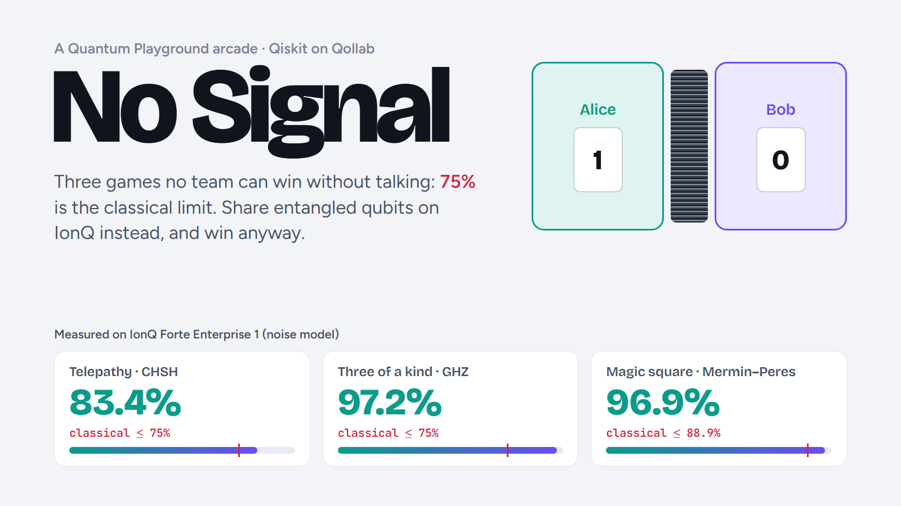

<p align="center"></p>

# No Signal

**[Play it on Qollab](https://qollab.xyz/u/master/no-signal)** · **[Demo video](https://youtu.be/HS_ywKyfT8k)** · **[How it works](#one-job-every-game)** · **[Results](#results)** · MIT


**Three games no team can win without talking, unless the players share entangled qubits.** Pick a machine in Qollab's runner, tune the players' strategies, and beat the classical limit on IonQ's trapped-ion noise models, IBM's superconducting noise models or an ideal simulator.

**On IonQ Forte Enterprise 1 (noise model):** one 28-qubit job gave Telepathy 83.4% (S = 2.67 ± 0.09, 14 standard errors above the classical 75%) and Three of a kind 97.2% (classical 75%). The magic square, over all nine row and column pairs (two jobs), won 96.9% against a classical 8 in 9. Fourteen machines are recorded in the [results](#results), and in every run Bob's answers stay within 3 standard errors of each other whatever card Alice holds.

This effort is supported by Qollab & IonQ.

## The games

In every game a referee hands each player a card. The players can't talk. They win if their answers fit a rule that links all the cards.

| Game | Players | Rule | Best without talking | With entanglement |
|---|---|---|---|---|
| **Telepathy** (CHSH) | 2 | answers match, unless both cards are 1, then they differ | 75% | 85.4% (Tsirelson's bound) |
| **Three of a kind** (GHZ) | 3 | the number of 1s answered is even if all cards are 0, odd otherwise | 75% | 100% |
| **Magic square** (Mermin–Peres) | 2 | Alice fills her row (even 1s), Bob his column (odd 1s); they must agree where they cross | 8 in 9 | 100% |

Each classical limit holds for every strategy, including shared random coins, which only pick between strategies. The lab checks this by brute force: 16 strategies for Telepathy, 64 for Three of a kind, and 4,096 grid pairs for the square.

## How to play

1. Press **Run** and pick a machine in **Select QPU**. The IonQ noise models are free and run on IonQ's cloud. The IBM noise models and the ideal simulators run in your browser.
2. **Your turn:** play twenty rounds of Telepathy as Alice. You see only your own card, and Bob follows the plan you agreed beforehand. A quantum team plays the same deals with real rounds from the recorded run, and the page keeps score and your streak.
3. Try the classical sandboxes. Flip the players' answers and watch every strategy hit the wall.
4. Tune the quantum strategy:
   - **Telepathy:** four dials, one measurement angle per player per card, with the predicted win rate updating live. The best angles are 0°, 45°, 22.5° and −22.5°.
   - **Three of a kind:** choose X or Y for each player's card.
5. Press **Play all three games**. One job runs every game; the page shows:
   - each game's win rate with a 95% interval;
   - its margin over the classical limit, in standard errors;
   - for Telepathy, the Bell parameter S;
   - a replay that races your quantum team against a best classical team on the same cards.
6. On IonQ a 29-qubit job fits only two magic-square rounds beside the other games, and the 8-in-9 limit only holds over all nine pairs. Choose **The whole magic square** under Play to fill a job with seven rounds, starting with the pairs not yet asked. Two jobs cover all nine.
7. IonQ machines take one job per run. Press **Stop**, then **Run**, to play again.

## One job, every game

IonQ's runners on Qollab accept one job of one circuit, so No Signal packs the games side by side in one circuit. On a 29-qubit Forte noise model that is 28 qubits:
- four Bell pairs for Telepathy, one per card pair (8 qubits);
- four GHZ states for Three of a kind (12 qubits);
- two magic-square rounds of two Bell pairs each (8 qubits).

Every shot plays every group, so each card set gets the same number of rounds. Local simulators run each card set as its own small circuit and cover all nine magic-square pairs.

**How each player measures:**
- **Telepathy:** each player measures their half of |Φ⁺⟩ along an angle, via RY(−2θ) and then Z. The answers match with probability cos²(θ_A − θ_B).
- **Three of a kind:** GHZ = (|000⟩ + |111⟩)/√2. Each player measures X (with H) or Y (with S† then H). ⟨XXX⟩ = +1 and ⟨XYY⟩ = −1, so X on card 0 and Y on card 1 always wins.
- **Magic square:** Alice and Bob share two Bell pairs. Each player measures a row or column of the Mermin–Peres square on their two qubits.
  - Alice's rows: XI, IX, XX; IZ, ZI, ZZ; −XZ, −ZX, YY.
  - Each row is measured with H gates, nothing, or CZ then H.
  - Bob's third column uses a Bell-basis measurement.
  - Rows multiply to +1 and columns to −1, so the parity rules hold every time and the shared square agrees.

**Scoring:**
- **Win rate:** the average over card sets, as if the referee dealt at random.
- **Bell parameter (Telepathy):** S = E₀₀ + E₀₁ + E₁₀ − E₁₁ = 8·win − 4. Classical teams reach at most 2; quantum mechanics allows up to 2√2.
- **No signalling:** from the same shots, Bob's answer rate for each of his cards is compared across Alice's two cards. Entanglement correlates the answers but carries no message.

## How much noise can entanglement take?

Noise washes the shared state toward random bits. The page models it with one number, the visibility v: each Bell pair becomes v·|Φ⁺⟩⟨Φ⁺| + (1 − v)·I/4, and the GHZ state likewise with I/8. Then:

| Game | Best quantum win rate at visibility v | Falls to the classical limit at |
|---|---|---|
| Three of a kind | ½ + v/2 | v = 50% |
| Telepathy | ½ + (cos²(π/8) − ½)·v | v = 1/√2 ≈ 71% |
| Magic square | (4(1 + v) + 5(1 + v²))/18 | v ≈ 85% |

The magic square is the most fragile. Four of its nine cells depend on one Bell pair and five on both, so noise hits it twice. A slider on the page drags v down and shows the three games falling to their limits in turn. Each recorded machine is placed at the visibility its Telepathy score implies, which turns the other two curves into predictions the measurements can miss. On the IonQ Forte models the GHZ prediction lands within 0.1 points of the measurement. On IBM's models GHZ falls 0.5 to 3 points below it, since a GHZ state needs two entangling gates where a Bell pair needs one. Each visibility estimate also carries about ±1.5 points of shot noise from Telepathy's 4,000 rounds. The tests check all three curves against Qiskit Aer, with a depolarizing channel inserted right after state preparation.

## Results

Recorded with the best strategies on Qollab's machines (see the page's atlas):

| Machine | Telepathy (75%) | S (≤ 2 classical) | Three of a kind (75%) | Magic square (88.9%) |
|---|---|---|---|---|
| IonQ Forte Enterprise 1 noise model | 83.4% (14 SE) | 2.67 ± 0.09 | 97.2% (83 SE) | 96.9% (43 SE) |
| IonQ Forte 1 noise model | 84.1% (16 SE) | 2.73 ± 0.09 | 98.2% (>100 SE) | 97.7% (55 SE) |
| IonQ Aria 1 noise model | 85.5% (19 SE) | 2.84 ± 0.09 | 98.6% (>100 SE) | — |
| IonQ Aria 2 noise model | 84.8% (17 SE) | 2.78 ± 0.09 | 98.2% (>100 SE) | — |
| IBM Aachen noise model | 83.6% (15 SE) | 2.69 ± 0.09 | 97.4% (87 SE) | 97.3% (49 SE) |
| IBM Berlin noise model | 83.6% (15 SE) | 2.69 ± 0.09 | 95.4% (61 SE) | 95.5% (30 SE) |
| IBM Boston noise model | 85.8% (19 SE) | 2.86 ± 0.09 | 97.6% (92 SE) | 98.2% (66 SE) |
| IBM Fez noise model | 84.6% (17 SE) | 2.77 ± 0.09 | 98.4% (>100 SE) | 98.0% (61 SE) |
| IBM Kingston noise model | 83.9% (15 SE) | 2.71 ± 0.09 | 97.1% (82 SE) | 96.7% (41 SE) |
| IBM Marrakesh noise model | 85.0% (18 SE) | 2.80 ± 0.09 | 98.6% (>100 SE) | 98.4% (71 SE) |
| IBM Miami noise model | 83.7% (15 SE) | 2.69 ± 0.09 | 94.3% (52 SE) | 94.9% (26 SE) |
| IBM Pittsburgh noise model | 84.9% (17 SE) | 2.79 ± 0.09 | 97.8% (96 SE) | 97.6% (53 SE) |
| AWS Braket local simulator | 85.6% (19 SE) | 2.85 ± 0.09 | 100.0% | 100.0% |
| Built-in simulator | 85.0% (18 SE) | 2.80 ± 0.09 | 100.0% | 100.0% |
| *ideal (theory)* | 85.4% | 2.83 | 100% | 100% |

SE: standard errors above the classical limit. S is shown with its 95% interval. On the IonQ Forte models the magic square pools two jobs, so it covers all nine row and column pairs. Aria's 21 qubits leave no room for the square beside the other games.

## What this shows, and what it doesn't

- **Not a loophole-free Bell test.** A real one separates the players far enough that no signal could pass, and detects every particle, as Hensen et al. did in 2015. The 2022 Nobel Prize went to Aspect, Clauser and Zeilinger for this line of experiments. Here every qubit sits in one machine or one simulation. The games show quantum correlations, not a proof that nature is nonlocal.
- **Models, not hardware.** On a noise-model simulator, the numbers come from IonQ's or IBM's model of their machines.
- **Packed circuits.** On IonQ, all games share one circuit, so crosstalk on real hardware would count as noise.

## Files

```
index.html, main.css, main.js   the page (Qollab JS project)
ui/                              Your turn game, sandboxes, angle dials and bases, results, race, noise budget, atlas
nosig/games.py                   the three games as circuits, scoring rules and brute-force classical bounds
nosig/play.py                    one job on the chosen machine; win rates, S, significance, the no-signal check
nosig/web.py                     what the page calls
data/atlas.json                  runs recorded on Qollab's machines (data/runs/*.json, merged by tools/atlas.py)
tests/                           checks against Qiskit Aer
```

## Built for the Qollab × IonQ hackathon

Theme: **Quantum Playground**, a game where quantum effects are essential. Without entanglement, no strategy reaches the scores the page shows. Everything here was written during the build window (October 10–12, 2026), alongside the team's other entry, [Below threshold](https://qollab.xyz/u/master/below-threshold).

## References

1. Clauser, Horne, Shimony & Holt, *PRL* 23, 880 (1969). Tsirelson, *Lett. Math. Phys.* 4, 93 (1980).
2. Greenberger, Horne, Shimony & Zeilinger, *Am. J. Phys.* 58, 1131 (1990). Mermin, *Physics Today* 43(6), 9 (1990).
3. Mermin, *PRL* 65, 3373 (1990). Peres, *Phys. Lett. A* 151, 107 (1990). Aravind, *Am. J. Phys.* 72, 1303 (2004).
4. Hensen et al., "Loophole-free Bell inequality violation using electron spins separated by 1.3 kilometres", *Nature* 526, 682 (2015).

MIT licence.
